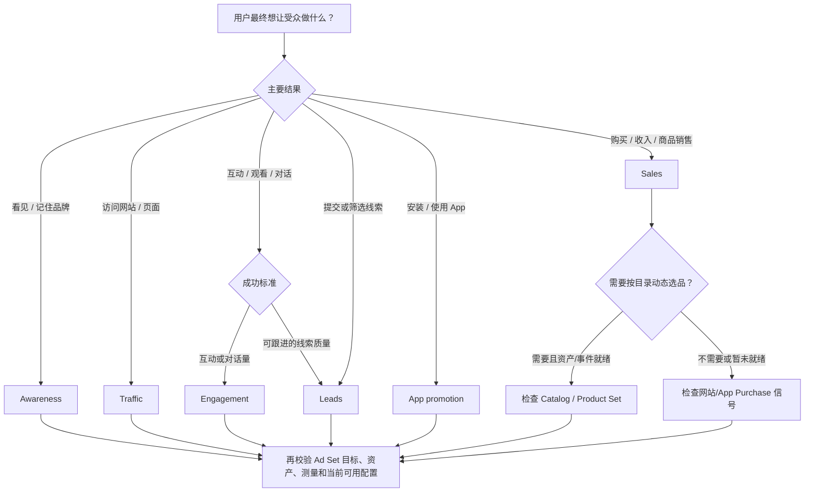

# Meta 投放目标选择：从业务结果到 Campaign Objective

## 先给结论

选择 Meta Campaign Objective 时，先说清楚业务希望用户完成什么，再映射到目标；不要把“转化、Catalog Sales、私信、触达”当成同一层级的多个现代目标。常见 ODAX 目标按业务结果分为 Awareness、Traffic、Engagement、Leads、App promotion、Sales。当前 API SDK 也保留了若干旧式 objective 值，因此 API 枚举不等于 Ads Manager 当前界面选项的完整清单；账户、地区、创建方式和 API 版本仍需现场核对。

## 先区分四层

```text
业务结果
  -> Campaign Objective（系统主要寻找哪类结果）
      -> Ad Set destination / performance goal / optimization event
          -> 业务 KPI 与回传质量
```

Campaign Objective 是投放方向，不是 KPI 本身。Ad Set 的目标、落地位置和优化事件细化了系统怎样寻找结果；最终还要以业务指标验证结果是否有价值。

## 目标选择表

| 用户真正要的结果 | Objective 候选 | 选择时继续确认 |
|---|---|---|
| 让更多目标人群看到或记住品牌 | Awareness | 主要看覆盖、展示或记忆相关结果；是否需要增量/品牌提升测量 |
| 把用户带到网站、页面或内容 | Traffic | 点击还是落地页浏览；页面加载、受众质量及后续转化是否可测 |
| 帖子互动、视频观看或开始对话 | Engagement | 互动/观看/消息目的地；若核心是可销售的合格线索，应比较 Leads 路径 |
| 收集或筛选业务线索 | Leads | Instant Form、网站、通话或可用的消息目的地；如何回传 MQL/SQL 等后端质量 |
| 获取 App 安装或推动应用内行为 | App promotion | 应用商店、SDK/MMP、优化事件和归因链路是否就绪 |
| 网站、App、Shop 或商品目录销售 | Sales | Purchase/value 信号是否可靠；是否有可用 Catalog/Product Set 和商品事件 |

Objective 和可选的 optimization goal、destination、billing event 之间存在依赖；组合是否可用不能仅凭这张业务表推断，应以当前账户的 Ads Manager、API 版本和注册 Tool schema 校验。

## 高频混淆

### Catalog Sales

“Catalog Sales”是常见业务/广告形式说法，不应直接当作与 Sales 并列的第七个现代 ODAX 目标。若业务结果是商品购买，通常从 Sales 出发；是否使用 Catalog、Product Set、动态商品和目录事件，是之后要确认的投放配置。没有 Catalog 也不代表不能以网站 Purchase 为目标。

### Conversion / 转化

“转化”通常描述用户要完成的业务动作或衡量事件，并不总是当前 Campaign 层的目标名称。购买、注册、提交线索、安装 App 等动作应分别映射到适合的 Objective 和可用优化事件；不要把旧标签 `CONVERSIONS` 当作所有转化型需求的通用现代选择。

### Messages / 私信

“消息”描述一种目的地或优化结果，不宜机械地作为独立第七类 Objective。若希望增加对话量，检查当前可用的 Engagement/消息组合；若希望获得并筛选合格线索，检查 Leads 是否支持符合业务的目的地和优化方式。两者以“对话开始”还是“合格线索/后端销售”为成功标准来区分，具体组合以账户和当前 API/界面为准。

### App 安装与应用内价值

若主要结果是安装或应用内事件，优先检查 App promotion 的应用、事件和归因链路。若最终目标是应用内购买或价值，应确认深层事件是否稳定回传；不要只因为安装容易计数就把安装量当成业务成功。

## 快速决策路径



## 选型前最少确认

1. **业务终点**：曝光、访问、互动、有效线索、安装、购买还是收入价值？
2. **转化位置**：网站、Instant Form、消息、电话、App、Shop 或实体门店？
3. **信号可用性**：Pixel/Dataset、App SDK/MMP、Catalog feed、CRM 回传是否可用且质量可解释？
4. **成功指标**：平台可观察事件之外，业务如何判断线索质量、购买利润或留存？
5. **约束条件**：账户/地区、特殊广告类别、素材与资产、预算和时间要求是否改变可用组合？

若缺少业务终点或转化位置，不要替用户拍板；先用一个简短问题补足。信息齐全时给出首选 Objective、备选路径、所需信号和主要风险。

## 运营判断边界

- 不把“每周固定转化量”、固定 CPA 倍数或固定预算门槛说成所有 Meta Campaign 的平台硬要求。样本是否足够，要结合事件、账户历史、预算、投放时长和转化延迟判断。
- 不以低价点击或高互动直接代表销售效果；沿着曝光/访问/事件/有效线索或收入逐层验收。
- 不承诺某个 Objective 必然带来最低 CPA、更多销售或更快学习；目标只是改变优化方向，结果仍受信号质量、市场、创意和测量影响。
- 旧式 API objective 值可能仍出现在 SDK 或存量 Campaign 中，不代表可用于新建，也不应把它们和 ODAX 标签混为一谈。

## 建议回答结构

用户只问“投放目标”时，先用一句话说明选择原则，再给六目标速查表；随后挑出与用户场景最相关的决策分支、必备信号和一个简短示例。只有流程确实复杂时才加 Mermaid 图。将平台事实、运营建议和待确认项分开，不附加未被询问的产品能力清单。

## 官方参考

- [Meta for Business：Ad objectives](https://www.facebook.com/business/ads/ad-objectives)
- [Meta Marketing API Python SDK：Campaign objective enums](https://github.com/facebook/facebook-python-business-sdk/blob/main/facebook_business/adobjects/campaign.py)
- [Meta Marketing API Python SDK：Ad Set optimization goals and destinations](https://github.com/facebook/facebook-python-business-sdk/blob/main/facebook_business/adobjects/adset.py)
- Wiki: [[Meta Ads 账户、层级与目标体系]]
- Wiki: [[Meta ODAX、Advantage 自动化与创意学习方法]]
